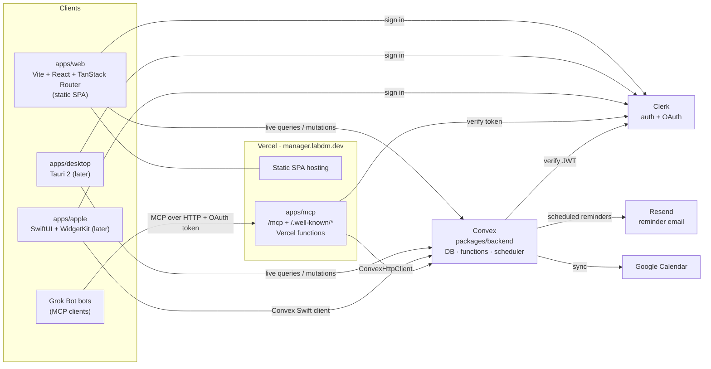
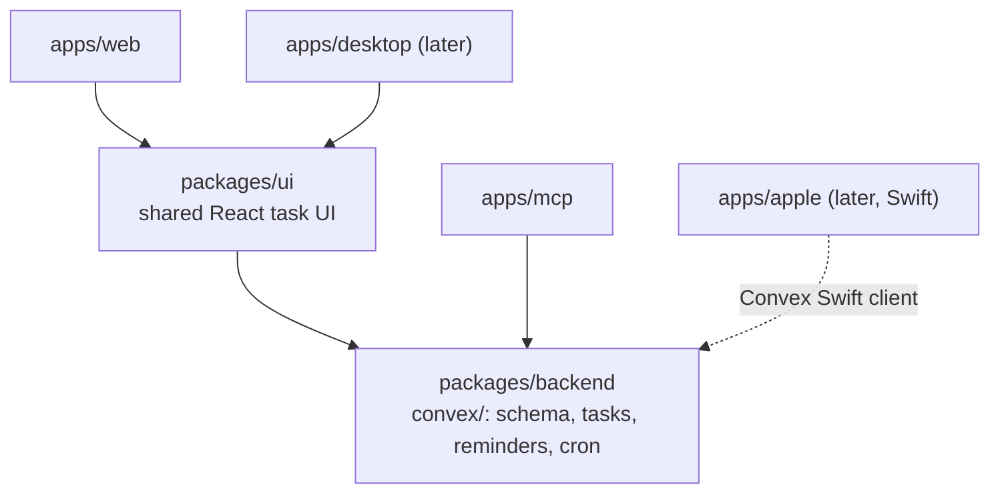

# Manager — Architecture

Personal task manager: tasks with checkboxes, due dates and reminders, Google Calendar link, and an MCP server so Grok Bot bots can create, read and complete tasks in the background.

## System overview

## Monorepo layout (pnpm workspaces)

| Path | What | Notes |
|---|---|---|
| `packages/backend` | Convex schema and functions | Single source of truth for domain logic. Clients import generated `api.*` types. |
| `packages/ui` | Shared React components and screens | Client-only; must build as a static SPA (no SSR). |
| `apps/web` | Web app | Vite + React + TanStack Router, deployed as static files on Vercel. |
| `apps/mcp` | MCP server | `mcp-handler` + `@clerk/mcp-tools` as Vercel functions; thin layer that calls Convex. |
| `apps/desktop` | Desktop app (later) | Tauri 2, mainly Windows, reuses `packages/ui`. |
| `apps/apple` | iOS / macOS app (later) | Native SwiftUI, WidgetKit widgets, Convex Swift client. |

## Key decisions

1. **Static SPA, no Next.js.** Tauri can only ship a static build, so the UI is a client-only SPA shared by web and desktop. No server components or server actions in UI code.
2. **Convex is the backend for every client.** Clients call Convex directly for live updates: a task closed by a bot via MCP appears on every screen immediately. Reminders use Convex scheduled functions and cron.
3. **Domain logic lives only in `packages/backend`.** Clients and MCP stay thin. This keeps the Convex lock-in contained: replacing it later means rewriting one layer, not every client.
4. **MCP is a separate small server.** The SPA has no server, so `/mcp` and the OAuth metadata live in `apps/mcp` on Vercel functions. It authenticates with Clerk OAuth and calls Convex functions.
5. **No public REST API for now.** If an external integration (Shortcuts, webhooks, Zapier) needs one, add Convex HTTP actions on top of the same functions.
6. **Apple platforms are native SwiftUI.** Widgets, App Intents and Live Activities need native code, so iOS/macOS get a SwiftUI app later instead of a web wrapper.

## Auth

Clerk everywhere: the React SDK on web and desktop, a Clerk-issued JWT verified by Convex, and Clerk OAuth for MCP clients (token audience `https://manager.labdm.dev/mcp`). MCP access is limited to the admin user.

## Integrations

Third-party integrations (Resend, Google Calendar) run as Convex actions in the Node runtime inside `packages/backend`, not on a separate server. They are triggered by Convex mutations and the scheduler, so a change from any client or MCP and its side effects stay in one place. Inbound callbacks (Google OAuth redirect, Calendar push webhooks) are Convex HTTP actions. `apps/mcp` stays a thin token-check-and-call layer.

## Reminders

Convex stores `dueAt` / `remindAt` and schedules a function at that time. Channels: email via Resend (default), Web Push (opt-in, on iPhone only as a Home Screen PWA). Google Calendar sync comes later.
