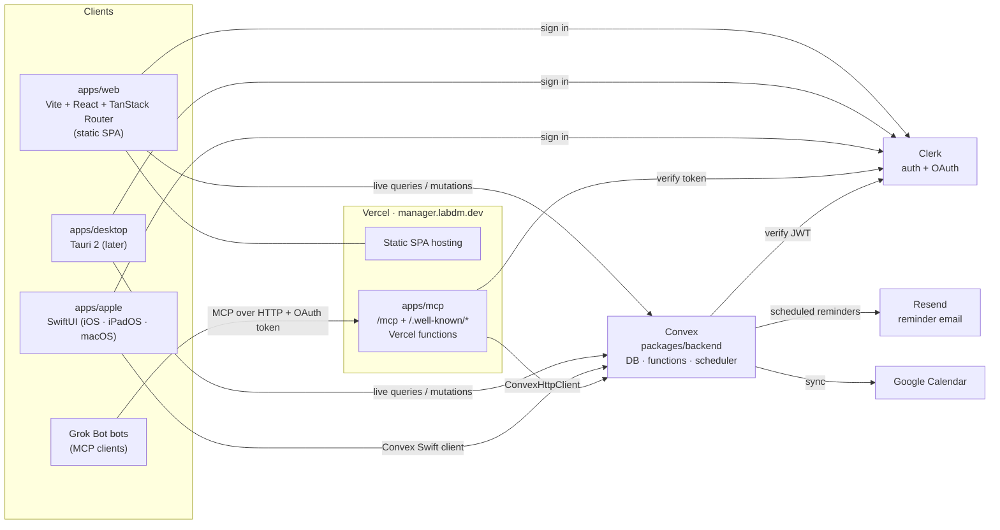
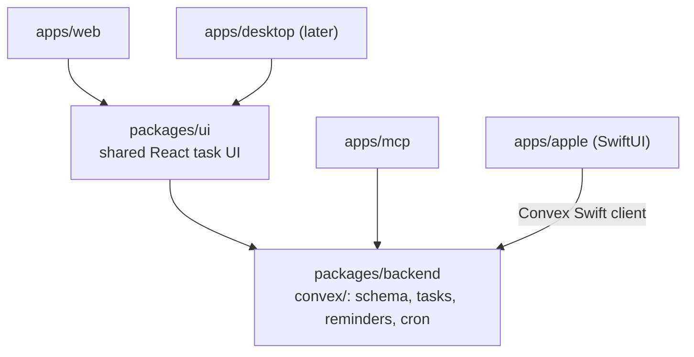

# Manager — Architecture

Personal task manager: tasks with checkboxes, due dates and reminders, Google Calendar link, and an MCP server so Grok Bot bots can create, read and complete tasks in the background.

## System overview

## Monorepo layout (pnpm workspaces)

| Path | What | Notes |
|---|---|---|
| `packages/backend` | Convex schema and functions | Single source of truth for domain logic. Clients import generated `api.*` types. |
| `packages/ui` | Shared React components and screens | Client-only; must build as a static SPA (no SSR). |
| `apps/web` | Web app | Vite + React + TanStack Router, deployed as static files on Vercel. |
| `apps/mcp` | MCP server | `mcp-handler` + `@clerk/mcp-tools` as Vercel functions; thin layer that calls Convex. |
| `apps/desktop` | Desktop app (later) | Tauri 2, mainly Windows, reuses `packages/ui`. |
| `apps/apple` | Apple client | One SwiftUI app target for iPhone (including the Duo), iPad and Mac; Convex Swift client + ClerkKit. |

## Key decisions

1. **Static SPA, no Next.js.** Tauri can only ship a static build, so the UI is a client-only SPA shared by web and desktop. No server components or server actions in UI code.
2. **Convex is the backend for every client.** Clients call Convex directly for live updates: a task closed by a bot via MCP appears on every screen immediately. Reminders use Convex scheduled functions and cron.
3. **Domain logic lives only in `packages/backend`.** Clients and MCP stay thin. This keeps the Convex lock-in contained: replacing it later means rewriting one layer, not every client.
4. **MCP is a separate small server.** The SPA has no server, so `/mcp` and the OAuth metadata live in `apps/mcp` on Vercel functions. It authenticates with Clerk OAuth and calls Convex functions.
5. **No public REST API for now.** If an external integration (Shortcuts, webhooks, Zapier) needs one, add Convex HTTP actions on top of the same functions.
6. **Apple platforms are native SwiftUI.** One app target covers iPhone (including the foldable Duo), iPad and Mac. Compact width uses a single column; regular width uses `NavigationSplitView`. Widgets, App Intents, Live Activities and CarPlay need separate targets or entitlements and are not included yet.
7. **Native code is split by dependency weight.** `ManagerKit` holds pure logic and SwiftUI views with no Convex/Clerk imports, so its tests run with Command Line Tools. `ManagerData` alone wraps ConvexMobile and ClerkKit. The Xcode project is generated by XcodeGen from `apps/apple/project.yml`; `pnpm apple:project` also writes the gitignored `Config/Secrets.plist` from the existing env files.

## Auth

Clerk everywhere: the React SDK on web and desktop, `ClerkKit` + `ClerkConvexAuthProvider` on Apple, a Clerk-issued JWT verified by Convex, and Clerk OAuth for MCP clients (token audience `https://manager.labdm.dev/mcp`). MCP access is available to any authenticated user.

## Apple client

The native app subscribes to `tasks:list` over Convex's websocket and writes through `tasks:create`, `tasks:setDone` and `tasks:remove` in `packages/backend/convex/tasks.ts`. `tasks:setDone` is an explicit setter, so a retried checkbox tap cannot invert itself. Optimistic updates live in `ManagerCore.TaskBoardModel`, which rolls back when a mutation fails. The web and MCP mutations stay unchanged.

Setup, commands and platform constraints are in [apps/apple/README.md](../apps/apple/README.md). CI runs `pnpm apple:test` and ad-hoc-signed iOS-simulator/macOS builds in a separate arm64 workflow.

## Downloads

`/download` is a static SPA route in `apps/web` backed by `packages/ui`. It lists GitHub release assets for the web app and macOS for everyone. `downloads:list` is a Convex action that reads GitHub releases, classifies assets by filename and removes iOS assets unless the signed-in Convex user has the `admin` role. The filtering happens in Convex so the asset URLs never reach a non-admin browser. The repository is private, so the Convex deployment needs `GITHUB_TOKEN` with `Contents: read` to see releases; the token stays on Convex and never reaches the browser.

`.github/workflows/release.yml` builds all three artifacts on an arm64 macOS runner and publishes each as both `.zip` and `.tar.gz` GitHub release assets: the static web build, an ad-hoc-signed macOS app and an ad-hoc-signed iOS Simulator app. CI workflows also upload per-commit artifacts with `actions/upload-artifact`. Preview deployments do not list release assets: they link to the production download page and CI runs instead, since Actions artifacts are short-lived and require GitHub access.

## Integrations

Third-party integrations (Resend, Google Calendar) run as Convex actions in the Node runtime inside `packages/backend`, not on a separate server. They are triggered by Convex mutations and the scheduler, so a change from any client or MCP and its side effects stay in one place. Inbound callbacks (Google OAuth redirect, Calendar push webhooks) are Convex HTTP actions. `apps/mcp` stays a thin token-check-and-call layer.

## Reminders

Convex stores `dueAt` / `remindAt` and schedules a function at that time. Channels: email via Resend (default), Web Push (opt-in, on iPhone only as a Home Screen PWA). Google Calendar sync comes later.
