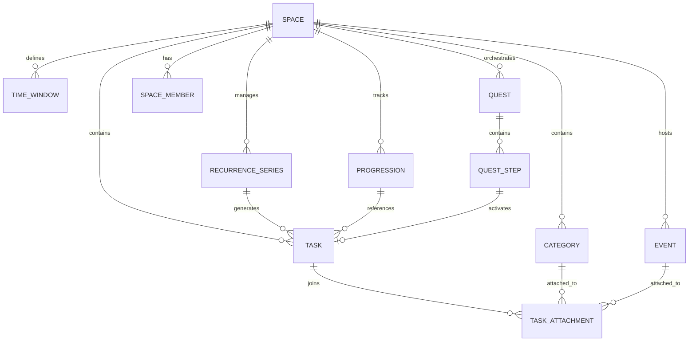

# Manager: Product & Technical Architecture Plan
**Author:** Gemini 3.8 Flash (Manager Council)  
**Date:** November 23, 2026  
**Status:** Council Proposal  
**Target:** `/Users/dmytroafonin/Projects/manager/docs/council/gemini-3.8-plan.md`

---

## 1. Introduction

Manager is an ADHD-first, gamified, agent-first life manager. It rejects the core premise of conventional productivity software. Standard todo apps are built for neurotypical linear planners; for an ADHD mind, they function as shame engines. A conventional task list piles up indefinitely, turning past-due items into an intimidating wall of red badges. The result is predictable: cognitive overload, executive paralysis, task avoidance, and eventual abandonment of the system. Manager exists to dismantle this cycle by treating executive dysfunction not as a personal failure to be punished, but as an engineering constraint to be solved.

The product achieves this by borrowing proven engagement mechanics from modern game design, specifically live-service and gacha progression loops. In gacha games, objectives are structured, bounded, time-boxed, and intrinsically rewarding. You have daily rituals, weekly milestones, themed seasons, and clear progression tracks that deliver immediate, predictable dopamine feedback. Tasks are not an endless abyss; they belong to a defined slice of time and context. Most importantly, game systems understand momentum: missing a day does not punish you with an unpayable debt that ruins the game forever. It resets, reshuffles, or transitions gracefully.

Crucially, we now correct a key foundational premise from early drafts. The initial concept asserted an absolute rule: "dailies never stack." While well-intentioned—aimed at preventing backlog guilt—an absolute ban breaks real-world human behavior. If you miss washing the dishes yesterday, you cannot wash yesterday’s dishes today; yesterday's occurrence is moot and must be replaced in place. But if you miss writing in your journal or logging your daily medication, yesterday’s entry remains valid, necessary, and stackable for backfilling. Recurrence is therefore not a monolithic behavior. Manager replaces the blanket "never stack" dogma with an explicit, per-series mechanical choice: `replace` (evaporating occurrences that refresh in place) versus `stack` (persistent occurrences that accumulate independently).

At the center of this architecture sits the agent-first loop: `Agent → Manager (System of Record) → Native OS APIs (Push · Calendar · Reminders · Alarms)`. Manual task entry is a high-friction tax on limited executive function. Humans with ADHD struggle most with initiation: triaging disorganized email threads, parsing paperwork, breaking vague intentions into atomic steps, and estimating deadlines. In Manager, an autonomous AI agent acts as the external prefrontal cortex. The agent monitors incoming email, chat, and ambient documents; reasons over commitments; breaks ambiguous problems into structured quests and progressions; and writes directly into Manager over MCP (Model Context Protocol).

Manager acts as the single source of truth and state engine. Once commitments are stored in Manager, the backend fans them out to native device APIs—scheduling iOS/Android alarms for immediate focus, firing local push notifications, and synchronizing calendar blocks. The human user does not sit down to organize a spreadsheet; the human glances at a game-like Heads-Up Display (HUD), selects a quest or daily slice, executes the action, receives the dopamine ping, and moves forward. The manual UI exists as an accessible fallback and steering wheel, but the agent drives the record.

---

## 2. Domain Model

To build a flexible engine that supports gacha-like progression without degenerating into rigid spaghetti code, we must strictly define our primitives, untangle overloaded terminology, and separate core data invariants from UI presentation guidance.

### Resolving "Event" and Establishing Stable Terms

The word "event" is heavily overloaded across calendar tools, gacha games, and reactive software. We disambiguate these into three distinct concepts:
1. **`TimeWindow` (Temporal Container):** A pure chronological boundary on the calendar with `startsAt` and `endsAt` epoch timestamps, operating on a specific cadence (`daily`, `weekly`, `monthly`, `quarterly`, `yearly`, `custom`). It has no game lore; it represents "today," "this week," or "November 2026."
2. **`Event` (Thematic Campaign / Happening):** A bounded context or narrative campaign that can span anywhere from 3 days to 3 months. Examples include "Winter Solstice Season" (a 90-day seasonal event), "Tax Filing Sprint" (a 30-day administrative event), or "Tokyo Vacation" (a 10-day trip). A "Season" in Manager is simply an `Event` with a longer duration and seasonal presentation metadata.
3. **`Task` (Atomic Actionable):** The fundamental unit of execution. Can stand alone or attach to Windows, Events, Categories, Quests, or Progressions.

### Core Entities & Relationships



#### 1. Space (`spaces` & `spaceMembers`)
- **Purpose:** The security, sharing, and tenancy boundary. Replaces per-item ACLs.
- **Fields:** `_id`, `name`, `slug`, `icon`, `ownerId`, `isPersonal`, `deletedAt`.
- **Members:** `spaceId`, `userId`, `role` (`owner`, `admin`, `member`), `deletedAt`.
- **Invariant:** Every task, category, event, progression, and quest belongs to exactly one `spaceId`. Access checks evaluate space membership.

#### 2. Task (`tasks`)
- **Purpose:** The atomic unit of work.
- **Fields:**
  - `_id`, `spaceId`, `ownerId` (creator).
  - `title` (string, max 200 chars).
  - `notes` (optional markdown string).
  - `done` (boolean).
  - `doneAt` (optional epoch ms).
  - `plannedDate` (optional string `YYYY-MM-DD` or midnight epoch ms — date without time).
  - `plannedTime` (optional number — minutes from midnight 0..1439 or epoch ms timestamp).
  - `dueAt` (optional epoch ms — hard deadline timestamp, wire float).
  - `priority` (number: 0 = Critical/P0, 1 = High/P1, 2 = Normal/P2, 3 = Low/P3).
  - `location` (optional object: `{ name?: string, address?: string, lat?: number, lng?: number }`).
  - `recurrenceSeriesId` (optional reference to `recurrenceSeries`).
  - `primaryCategoryId` (optional reference to `categories` for fast indexing).
  - `primaryEventId` (optional reference to `events` for fast indexing).
  - `progressionId` (optional reference to `progressions`).
  - `questId` (optional reference to `quests`).
  - `overduePolicy` (enum: `carry_forward` | `retire` | `escalate`). Defaults to `carry_forward`.
  - `deletedAt` (optional epoch ms — soft delete tombstone).

#### 3. Task Attachment (`taskAttachments`)
- **Purpose:** Enables multi-attachment without schema distortion. A task can belong to multiple categories, events, or windows.
- **Fields:** `_id`, `taskId`, `spaceId`, `entityType` (`category` | `event` | `timeWindow`), `entityId` (generic string ID), `isPrimary` (boolean), `deletedAt`.

#### 4. Recurrence Series (`recurrenceSeries`)
- **Purpose:** Template that governs recurring task generation and lifecycle.
- **Fields:**
  - `_id`, `spaceId`, `ownerId`, `title`.
  - `cadence` (object: e.g. `{ type: "daily", interval: 1 }` or `{ type: "weekly", daysOfWeek: [1, 3, 5] }` or cron).
  - `behavior`: `replace` | `stack`.
    - `replace`: Uncompleted prior instances are expired/overwritten; only one active pending task exists per series.
    - `stack`: Past uncompleted instances remain alive as individual tasks for auditing/backfilling.
  - `overduePolicy`: `retire` | `escalate` | `carry_forward`.
  - `templateTaskId`: configuration template for created tasks.
  - `lastGeneratedWindowEnd`: epoch ms.
  - `deletedAt`: optional epoch ms.

#### 5. Event / Season (`events`)
- **Purpose:** Themed, time-boxed campaigns (seasons, limited events, sprints, projects).
- **Fields:**
  - `_id`, `spaceId`, `ownerId`, `title`, `description`.
  - `type`: `season` | `limited_event` | `campaign` | `custom`.
  - `startsAt`: epoch ms.
  - `endsAt`: epoch ms.
  - `presentationId`: optional string pointing to a presentation pack theme.
  - `bannerUrl`: optional string.
  - `deletedAt`: optional epoch ms.

#### 6. Time Window (`timeWindows`)
- **Purpose:** System-managed or user-defined temporal buckets for UI slicing.
- **Fields:**
  - `_id`, `spaceId`, `cadence` (`daily` | `weekly` | `monthly` | `quarterly` | `yearly` | `custom`).
  - `startsAt`: epoch ms.
  - `endsAt`: epoch ms.
  - `title`: string (e.g. "Today", "Week 48", "Q4 2026").
  - `deletedAt`: optional epoch ms.

#### 7. Progression (`progressions`)
- **Purpose:** Quantified goal tracking with known target size (e.g., 30-day workout, 500-page book).
- **Fields:**
  - `_id`, `spaceId`, `ownerId`, `title`.
  - `currentValue`: number (Convex float).
  - `targetValue`: number (Convex float).
  - `unit`: string (e.g., "pages", "km", "sessions", "days").
  - `resetCadence`: optional `daily` | `weekly` | `monthly` | `none`.
  - `deletedAt`: optional epoch ms.

#### 8. Quest & Quest Steps (`quests`, `questSteps`)
- **Purpose:** Sequential, dependency-driven task chains. Supports both deterministic pipelines and emergent branching.
- **Fields (`quests`):**
  - `_id`, `spaceId`, `ownerId`, `title`, `description`.
  - `status`: `active` | `completed` | `abandoned`.
  - `isEmergent`: boolean (if true, steps are discovered iteratively).
  - `deletedAt`: optional epoch ms.
- **Fields (`questSteps`):**
  - `_id`, `questId`, `stepIndex`: number (0-based order).
  - `taskId`: Id<"tasks"> (the task executed for this step).
  - `unlockCondition`: `previous_completed` | `manual` | `external_signal`.
  - `isDiscovered`: boolean (true if visible to the user; false if waiting for prior step resolution).
  - `status`: `locked` | `available` | `completed`.
  - `deletedAt`: optional epoch ms.

### Core Invariants vs. UI Guidance

| Rule | Classification | Enforcement Mechanism |
|---|---|---|
| **Soft deletion everywhere** | **Core Invariant** | Schema has `deletedAt`. All mutation services patch `deletedAt`. All live queries filter `deletedAt === undefined`. |
| **Domain logic in Convex** | **Core Invariant** | No client (Web, iOS, Android, MCP) mutates DB directly. All logic resides in `packages/backend/convex/`. |
| **Multi-attachment allowed** | **Core Invariant** | Schema supports `taskAttachments` junction table; core never throws an error on >1 attachment. |
| **Primary attachment guidance** | **UI Guidance** | Clients populate `primaryCategoryId` and `primaryEventId` for simple rendering; UI pickers emphasize one main home. |
| **Seasons can be any length** | **Core Invariant** | `events` table accepts any `startsAt` / `endsAt` range. A 3-day sprint or 120-day season are equally valid. |
| **Quests can be pre-known or emergent** | **Core Invariant** | `questSteps` table allows pre-populating N steps or appending step N+1 dynamically. Core does not mandate either. |
| **Dailies stack or replace** | **Core Invariant** | `recurrenceSeries.behavior` strictly validates `replace` vs `stack` at the backend service level. |
| **Card vs. Row rendering** | **UI Guidance** | Stored in user preferences or client UI toggle; core schema does not restrict representation. |

---

## 3. Prebuilt Catalog

To prevent rigid lock-in, the catalog entries below are **seed data** (default database rows provisioned during workspace initialization or installed via presentation packs), **NOT** frozen TypeScript enum types that reject user customization.

### Categories (Seed Data)
1. **Household (`household`):** Chores, repairs, home maintenance, groceries. Default icon: `home`, color: `#10B981` (Emerald).
2. **Health & Vitality (`health`):** Exercise, medication, meals, sleep, mental hygiene. Default icon: `heart-pulse`, color: `#EC4899` (Pink).
3. **Relationships & Social (`relationships`):** Family check-ins, date nights, birthdays, gifts, letters. Default icon: `users`, color: `#8B5CF6` (Purple).
4. **Career & Work (`work`):** Deep work blocks, meetings, project milestones, admin duties. Default icon: `briefcase`, color: `#3B82F6` (Blue).
5. **Personal Growth & Projects (`growth`):** Reading, coding side projects, language practice, creative arts. Default icon: `sparkles`, color: `#F59E0B` (Amber).
6. **Finances & Legal (`finances`):** Bills, taxes, investments, expense filing. Default icon: `landmark`, color: `#14B8A6` (Teal).

### Built-in Windows (Seed Cadences)
- **Daily (`daily`):** Rolling 24-hour window from midnight to 23:59:59 local user time.
- **Weekly (`weekly`):** Rolling 7-day window starting on Monday 00:00:00 local time.
- **Monthly (`monthly`):** Calendar month container.
- **Quarterly (`quarterly`):** Q1–Q4 corporate/personal review windows.
- **Yearly (`yearly`):** Annual goal horizons.
- **Custom (`custom`):** User- or agent-specified window (e.g., "14-day Sprint").

### Example Seasons (Themed Long-Horizon Events)
- **"Winter Solstice & Frostbloom":** 90-day winter season (Dec 1 – Feb 28). Thematic focus on cozy indoor maintenance, winter wellness, reflection, and holiday events. Pack ID: `season-winter-frost`.
- **"Spring Awakening & Renewal":** 60-day sprint (Mar 1 – Apr 30). Thematic focus on deep decluttering, outdoor activity restoration, and tax wrap-up. Pack ID: `season-spring-renewal`.
- **"Q1 Financial Fortress":** 90-day thematic event focusing on budget auditing, tax preparation, and subscription cleanup.

### Example Limited Windows (Short-Horizon Events)
- **"Tax Filing Sprint 2026":** Bounded window ending April 15. Overdue policy: `escalate`.
- **"Seasonal Delicacy / Limited Run":** 7-day window ending March 31 (e.g. limited restaurant special or pop-up market). Overdue policy: `retire`.

### Recurrence Behaviors
- **`replace`:** The occurrence evaporates upon expiration. Missing a day refreshes the task to the current date. Ideal for hygiene, dishwashing, daily tidy-up, taking out trash.
- **`stack`:** The occurrence persists as an unresolved ledger item. Missing three days leaves three distinct tasks. Ideal for gratitude journaling, medication logs, logging daily study time, or tracking expense receipts.

### Overdue Policies
- **`retire`:** When the deadline or window ends, the task transitions to an archived/expired state. It disappears from active views without penalty or negative red flags. Eliminates ADHD shame.
- **`escalate`:** When the deadline passes, the task automatically bumps its priority (e.g., P2 → P1 → P0), pulses visually in the HUD, and triggers agent notifications. Reserved for commitments with severe real-world consequences (taxes, legal filings, utility payments).
- **`carry_forward`:** Standard gentle rollover. The task remains active and automatically floats into the current window at the same priority level.

### Priority Scale
- **P0 / Critical (`priority: 0`):** Immediate consequence if ignored (e.g., urgent leak, filing taxes today). Gacha presentation: *Legendary / SSR Tier (Crimson Pulse)*.
- **P1 / High (`priority: 1`):** Must be addressed within current window. Gacha presentation: *Epic / SR Tier (Gold Glow)*.
- **P2 / Normal (`priority: 2`):** Standard daily/weekly commitment. Gacha presentation: *Rare / R Tier (Amethyst / Cyan)*.
- **P3 / Low (`priority: 3`):** Casual, optional, backlog explorer. Gacha presentation: *Common / N Tier (Slate Gray)*.

### Starter Quests
- **Emergent Quest: "Repair the Broken Window":**
  - *Step 1 (Discovered):* Call Landlord to report damage.
  - *Step 2 (Locked / Undiscovered):* Triggered by outcome of Step 1 (branches to "Hire glazier" OR "Wait for landlord inspection" OR "Submit reimbursement receipt").
- **Deterministic Quest: "Apartment Relocation Protocol":**
  - *Step 1:* Sign lease & transfer deposit.
  - *Step 2:* Book moving truck for moving day.
  - *Step 3:* Pack kitchen and fragile goods.
  - *Step 4:* Change mailing address and transfer fiber internet.

### Starter Progressions
- **"Dune Reading Journey":** Target: 688, Unit: `pages`. Current: 140. Inline visual progression bar with milestone markers at 25%, 50%, 75%, 100%.
- **"100 Days of Movement":** Target: 100, Unit: `days`. Increments by 1 every time a linked health task is completed.

---

## 4. UI Shell

The UI shell takes direct inspiration from high-engagement gacha interfaces (e.g., *Genshin Impact*, *Honkai: Star Rail*, *Arknights*): clean, spatial, tactile, and segmenting information into distinct, bite-sized slices rather than infinite vertical scrolling.

### Recommended Default Layout: The Matrix Slicer (Vertical × Horizontal)

The screen is structured as an interactive 2D navigation matrix:

```
┌──────────────────────────────────────────────────────────────────────────────┐
│ [Space Selector: Personal ▼]   [⚡ Energy / Level]   [Active Season: Winter]  │
├──────────────┬───────────────────────────────────────────────────────────────┤
│ VERTICAL RAIL│ HORIZONTAL BAR: [Today (Daily)] [This Week] [Limited] [Tracks]│
│              ├───────────────────────────────────────────────────────────────┤
│ [🏠 Home/All]│ SLICE CONTENT: Household × Today                              │
│              │                                                               │
│ [🧹 House] ◄─┼──► [Card] Wash dishes today (Replace)       [DONE O]          │
│ [💖 Health]  │    [Card] Take morning vitamins              [DONE O]          │
│ [💼 Work]    │    [Row]  Take out recycling                [DONE O]          │
│ [🌱 Growth]  │                                                               │
│ [💰 Finance] │ PROGRESSION PINNED:                                           │
│ ──────────── │ [==================>                  ] 35% Winter Declutter  │
│ [⚔️ QUESTS]  │                                                               │
│ [🏆 SEASONS] │ QUESTS DRAWER / COMPACT VIEW:                                 │
│              │ ⚔️ Broken Window (Step 1 of ?: Call landlord)                 │
└──────────────┴───────────────────────────────────────────────────────────────┘
```

1. **Top HUD Bar:** Displays current Space switcher, active Season banner badge, global streak/level indicators, and quick agent command launcher.
2. **Vertical Navigation Rail (Left):** Categories (Household, Health, Work, Growth, Finance) plus two dedicated high-level operational spaces: **⚔️ Quests** and **🏆 Seasons**.
3. **Horizontal Navigation Bar (Top-Center):** TimeWindows and filter modes (Today / Daily, Weekly, Limited Events, Progression Tracks).
4. **The Slice (Center Stage):** The intersection of `Selected Vertical Tab × Selected Horizontal Window`.
   - Selecting `[Household] × [Today]` displays only household tasks assigned to today.
   - Selecting `[⚔️ Quests] × [All]` opens the full-screen Quest Log showing active, locked, and branching questlines.
   - Selecting `[🏆 Seasons] × [Active]` displays the seasonal campaign board and related limited events.
5. **View Density Flexibility:** Every slice allows instant toggling between **Cards** (large touch targets, metadata badges, rich progress bars) and **Rows** (compact, high-speed checklist style).
6. **Progression Bars:** Rendered either as a standalone card in the slice or pinned as an overview widget at the top of the category slice.

### Alternate Layout 1: The Command Deck (Timeline HUD)
- **Target Audience:** Work-heavy days or users who prefer a temporal timeline over categorical buckets.
- **Layout:**
  - **Horizontal Top Deck:** The primary driver is a calendar timeline scrubber (Day, Week, Month, Season).
  - **Vertical Sidebar (Right):** Collapsible drawer containing Categories, Quest Chains, and Agent logs.
  - **Center Stage:** A fluid Bento-Grid. Left side shows hourly/timed tasks; middle shows flexible untimed tasks for the selected date; right side shows active Progressions and next Quest steps.

### Alternate Layout 2: The Campaign Map (Codex & Expeditions)
- **Target Audience:** Pure gamification and quest-driven focus sessions.
- **Layout:**
  - **Vertical Rail:** Represents Questlines, Expeditions, and Seasons.
  - **Horizontal Bar:** Sub-chapters or locations (e.g., "Home Base", "Office", "Gym").
  - **Center Stage:** Tasks render as sequential node-based campaign nodes. Completing a node triggers a particle burst, unlocking the path to the next node on the canvas. Daily tasks appear in a "Daily Commissions" board in the corner.

### Presentation Packs: Theming without Schema Forks

To support radical visual customization without touching the backend:
- A **Presentation Pack** is a client-side bundle containing:
  - Color tokens, font choices, card border shaders, and background textures.
  - Iconography mapping for categories and badges.
  - Sound effects (optional audio chimes on task completion).
  - Particle animation presets (confetti, cyber sparks, pixel burst).
- The database merely stores a string ID: `presentationId: "gacha-cyberpunk"` or `presentationId: "nordic-minimal"` on the `spaces`, `events`, or `users` table.
- Clients resolve `presentationId` against their local theme registry. If unknown, they fall back to `default-clean`. The Convex data layer remains 100% agnostic.

---

## 5. User Flows

### Flow 1: Daily Dishes (`replace` Recurrence Behavior)
1. **Setup:** User creates a daily chore: "Wash dishes after dinner". Sets recurrence to `daily`, behavior to `replace`.
2. **Tuesday Night:** User feels exhausted, skips the dishes, and goes to sleep without opening the app.
3. **Wednesday Morning:** The scheduled rollover runs. Because behavior is `replace`, Tuesday's uncompleted task does **not** linger as an overdue task. Instead, the system updates the task's planned window to Wednesday.
4. **User Experience:** User opens the app on Wednesday. They see exactly **one** "Wash dishes" task for today. There is no guilt, no "1 Overdue Task" red badge, and no requirement to mark yesterday done retroactively.

### Flow 2: Daily Journaling (`stack` Recurrence Behavior)
1. **Setup:** User sets up a daily habit: "Evening reflection journal". Sets recurrence to `daily`, behavior to `stack`.
2. **Tuesday & Wednesday:** User travels and forgets to journal on both days.
3. **Thursday Morning:** Because behavior is `stack`, Tuesday’s and Wednesday’s instances are **not** overwritten. They remain in the database with their respective planned dates.
4. **User Experience:** User opens the journal view on Thursday. They see three distinct entries: "Tuesday Journal (Missed)", "Wednesday Journal (Missed)", and "Thursday Journal (Today)". The user can backfill notes into Tuesday and Wednesday and mark them complete, preserving their audit trail and streak history.

### Flow 3: Tax Deadline with Escalation (`escalate` Overdue Policy)
1. **Setup:** Agent scans an incoming email from the IRS/accountant: "2025 Tax Return due on April 15 at 23:59". Agent creates a task "Submit 2025 Tax Return", setting `dueAt: 1776297599000`, `priority: 1` (High), and `overduePolicy: escalate`.
2. **April 15:** Task sits prominently in the "Tax Filing Sprint" event banner with a golden high-priority border.
3. **April 16, 00:01 AM (Deadline Passed):** The user has not marked the task complete. The backend overdue monitor runs.
4. **Escalation Trigger:** The policy detects an expired deadline with `escalate`. It automatically mutates `priority: 0` (Critical/SSR Tier).
5. **User Experience:** When the user wakes up, the task is pinned to the very top of their HUD with a pulsing crimson alert, native OS notifications are dispatched with high priority, and the agent sends a chat prompt offering immediate assistance to resolve the filing.

### Flow 4: Missed Limited Offer with Retirement (`retire` Overdue Policy)
1. **Setup:** User spots a promo: "McDonald's Holiday Pie returns until Dec 24". User asks the agent to log it. Agent creates task "Try Holiday Pie", links it to a 7-day limited event, and sets `overduePolicy: retire`.
2. **Dec 24:** User gets busy with family and forgets about the pie.
3. **Dec 25, 00:01 AM:** The window ends. The backend evaluates overdue items.
4. **Retirement Execution:** Instead of turning red or rolling over to Christmas Day, the task automatically marks `deletedAt: Date.now()` (or moves to an `expired` archived state).
5. **User Experience:** The user opens the app on Christmas morning. The Holiday Pie task has vanished cleanly. No overdue indicator appears. The temporary opportunity passed, and the interface remains calm and clutter-free.

### Flow 5: Broken-Window Emergent Quest
1. **Initiation:** User messages their agent: "A stone cracked my bedroom window. I have no idea how to deal with this."
2. **Quest Creation:** The agent creates a new Quest: "Repair Bedroom Window", marked `isEmergent: true`. Because the future path is unknown, the agent generates only **Step 1**: "Call landlord to report window damage and ask for repair policy".
3. **User Action:** The user sees the quest in their **⚔️ Quests** tab. Step 1 is active; future steps are obscured with a "??? (To be revealed)" card.
4. **Step 1 Completion:** User calls the landlord, taps "Done" on Step 1, and inputs a note: "Landlord said I can hire any licensed glazier, pay them, and deduct the receipt from next month's rent."
5. **Agent Dynamic Expansion:** The agent receives the completion webhook/event, reads the note, and dynamically appends two new steps to the Quest:
   - *Step 2:* "Get quotes from 2 local glaziers on Yelp/Google".
   - *Step 3:* "Send glazier invoice to landlord and deduct amount from rent check".
6. **User Experience:** The UI plays a quest update chime. Step 1 marks complete with a green checkmark, and Step 2 illuminates as the new immediate active target.

### Flow 6: Book Reading Progression
1. **Setup:** User begins reading *Dune* (688 pages). User creates a progression: "Read Dune", `targetValue: 688`, `unit: "pages"`, `currentValue: 0`.
2. **Integration:** User attaches a recurring daily task: "Read 20 pages of Dune" linked to the progression.
3. **Interaction:**
   - On Monday, user reads 30 pages. In the task card, user clicks the "+ Quick Log" button and enters `30`.
   - The progression updates to `30 / 688` (4.3%). The progress bar visibly fills and displays a subtle celebratory shimmer.
   - By week 3, the user hits page 172 (25%). The UI triggers a "Quarter Waypoint Milestone" badge and awards bonus gacha experience points.
4. **Display:** The reading progression can be viewed either as an inline bar widget in the "Personal Growth" category or as an expanded card in the "Tracks" horizontal tab.

### Flow 7: Sharing a Household Space
1. **Space Creation:** User creates a new Space named "Apartment 4B".
2. **Inviting Partner:** User navigates to Space Settings → Members → "Invite Member", entering their partner’s email or Clerk user handle.
3. **Invitation Acceptance:** Partner receives an invitation in their Manager app and accepts. Partner's `spaceMembers` record is written with role `member`.
4. **Entity Attachment:** User attaches the "Household" category, the "Fix Broken Window" quest, and a shared "Weekly Grocery List" task series to the "Apartment 4B" space.
5. **Collaboration:** When the partner marks "Buy almond milk" as done on their Android phone, Convex live queries instantly update the user’s macOS desktop and iOS app. The personal spaces of both users remain strictly isolated and private.

### Flow 8: Agent Creating Structured Entities from an Email
1. **Email Arrival:** The user’s email client receives a confirmation: "United Airlines: Flight to Tokyo departing Oct 12, returning Oct 22. Hotel booked at Shinjuku Prince."
2. **Agent Reasoning:** The external AI agent (e.g. Claude / Antigravity via MCP) reads the email context and determines that an upcoming international trip requires high-level structure, not just a bare checklist.
3. **MCP Batch Execution:** Over the `/mcp` endpoint, the agent executes structured tool calls:
   - `create_event`: `{ title: "Tokyo Vacation 2026", type: "campaign", startsAt: 1791763200000, endsAt: 1792627200000 }`.
   - `create_quest`: `{ title: "Trip to Tokyo Preparation", isEmergent: false }`.
   - `add_quest_step`: Steps for passport validity check, international roaming activation, packing list, and transit passes.
   - `create_task`: `{ title: "Check in for flight UA803", dueAt: 1791676800000, priority: 1, primaryEventId: <eventId> }`.
4. **User Notification:** Manager receives the data in Convex. The user opens the app and is greeted by a new "Tokyo Vacation 2026" event banner, a structured pre-trip questline, and scheduled boarding tasks already placed into their calendar and daily slices.

---

## 6. Technical Plan

### Convex Database Schema

The Convex schema in `packages/backend/convex/schema.ts` is updated additively to support all primitives while maintaining backwards compatibility with current queries.

```typescript
import { defineSchema, defineTable } from "convex/server";
import { v } from "convex/values";

export default defineSchema({
  // Users (Existing + Preferences)
  users: defineTable({
    tokenIdentifier: v.string(),
    name: v.optional(v.string()),
    email: v.optional(v.string()),
    role: v.union(v.literal("user"), v.literal("admin")),
    defaultSpaceId: v.optional(v.id("spaces")),
    activePresentationId: v.optional(v.string()),
  }).index("by_token", ["tokenIdentifier"]),

  // Spaces (Collaboration boundary)
  spaces: defineTable({
    name: v.string(),
    slug: v.string(),
    icon: v.optional(v.string()),
    ownerId: v.id("users"),
    isPersonal: v.boolean(),
    deletedAt: v.optional(v.number()),
  })
    .index("by_owner", ["ownerId"])
    .index("by_owner_deleted", ["ownerId", "deletedAt"]),

  // Space Members (Tenancy membership)
  spaceMembers: defineTable({
    spaceId: v.id("spaces"),
    userId: v.id("users"),
    role: v.union(v.literal("owner"), v.literal("admin"), v.literal("member")),
    invitedBy: v.id("users"),
    deletedAt: v.optional(v.number()),
  })
    .index("by_space", ["spaceId"])
    .index("by_user", ["userId"])
    .index("by_space_user", ["spaceId", "userId"]),

  // Categories (Organizational buckets)
  categories: defineTable({
    spaceId: v.id("spaces"),
    name: v.string(),
    slug: v.string(),
    icon: v.string(),
    color: v.string(),
    sortOrder: v.number(),
    ownerId: v.id("users"),
    deletedAt: v.optional(v.number()),
  })
    .index("by_space", ["spaceId"])
    .index("by_space_deleted", ["spaceId", "deletedAt"]),

  // Events & Seasons (Themed campaigns)
  events: defineTable({
    spaceId: v.id("spaces"),
    ownerId: v.id("users"),
    title: v.string(),
    description: v.optional(v.string()),
    type: v.string(), // "season", "limited_event", "campaign", "custom"
    startsAt: v.number(),
    endsAt: v.number(),
    presentationId: v.optional(v.string()),
    bannerUrl: v.optional(v.string()),
    deletedAt: v.optional(v.number()),
  })
    .index("by_space", ["spaceId"])
    .index("by_space_dates", ["spaceId", "startsAt", "endsAt"])
    .index("by_space_deleted", ["spaceId", "deletedAt"]),

  // Time Windows (Temporal containers for UI slicing)
  timeWindows: defineTable({
    spaceId: v.id("spaces"),
    cadence: v.string(), // "daily", "weekly", "monthly", "quarterly", "yearly", "custom"
    title: v.string(),
    startsAt: v.number(),
    endsAt: v.number(),
    deletedAt: v.optional(v.number()),
  })
    .index("by_space_cadence", ["spaceId", "cadence"])
    .index("by_space_dates", ["spaceId", "startsAt", "endsAt"]),

  // Recurrence Series (Governs generation & recurrence behavior)
  recurrenceSeries: defineTable({
    spaceId: v.id("spaces"),
    ownerId: v.id("users"),
    title: v.string(),
    cadenceConfig: v.string(), // JSON string representing cadence rule
    behavior: v.union(v.literal("replace"), v.literal("stack")),
    overduePolicy: v.union(
      v.literal("retire"),
      v.literal("escalate"),
      v.literal("carry_forward")
    ),
    templateTaskId: v.optional(v.id("tasks")),
    lastRolloverAt: v.optional(v.number()),
    deletedAt: v.optional(v.number()),
  })
    .index("by_space", ["spaceId"])
    .index("by_space_deleted", ["spaceId", "deletedAt"]),

  // Tasks (The Atomic Primitive)
  tasks: defineTable({
    title: v.string(),
    done: v.boolean(),
    doneAt: v.optional(v.number()),
    dueAt: v.optional(v.number()), // Convex wire float
    plannedDate: v.optional(v.string()), // YYYY-MM-DD
    plannedTime: v.optional(v.number()), // Minutes from midnight or epoch
    ownerId: v.id("users"),
    spaceId: v.optional(v.id("spaces")), // Optional for backward compatibility, backfilled to default space
    notes: v.optional(v.string()),
    priority: v.optional(v.number()), // 0=Critical, 1=High, 2=Normal, 3=Low
    location: v.optional(
      v.object({
        name: v.optional(v.string()),
        address: v.optional(v.string()),
        lat: v.optional(v.number()),
        lng: v.optional(v.number()),
      })
    ),
    recurrenceSeriesId: v.optional(v.id("recurrenceSeries")),
    primaryCategoryId: v.optional(v.id("categories")),
    primaryEventId: v.optional(v.id("events")),
    progressionId: v.optional(v.id("progressions")),
    questId: v.optional(v.id("quests")),
    overduePolicy: v.optional(
      v.union(
        v.literal("retire"),
        v.literal("escalate"),
        v.literal("carry_forward")
      )
    ),
    deletedAt: v.optional(v.number()), // Universal Soft Delete
  })
    .index("by_owner", ["ownerId"])
    .index("by_owner_deleted", ["ownerId", "deletedAt"])
    .index("by_space_deleted", ["spaceId", "deletedAt"])
    .index("by_space_category", ["spaceId", "primaryCategoryId", "deletedAt"])
    .index("by_space_event", ["spaceId", "primaryEventId", "deletedAt"])
    .index("by_series", ["recurrenceSeriesId", "deletedAt"]),

  // Task Attachments (Many-to-many junction table)
  taskAttachments: defineTable({
    taskId: v.id("tasks"),
    spaceId: v.id("spaces"),
    entityType: v.string(), // "category", "event", "timeWindow"
    entityId: v.string(),
    isPrimary: v.boolean(),
    deletedAt: v.optional(v.number()),
  })
    .index("by_task", ["taskId", "deletedAt"])
    .index("by_entity", ["entityType", "entityId", "deletedAt"]),

  // Progressions (Countable tracks)
  progressions: defineTable({
    spaceId: v.id("spaces"),
    ownerId: v.id("users"),
    title: v.string(),
    currentValue: v.number(),
    targetValue: v.number(),
    unit: v.string(),
    resetCadence: v.optional(v.string()),
    deletedAt: v.optional(v.number()),
  })
    .index("by_space", ["spaceId"])
    .index("by_space_deleted", ["spaceId", "deletedAt"]),

  // Quests (Multi-step directed chains)
  quests: defineTable({
    spaceId: v.id("spaces"),
    ownerId: v.id("users"),
    title: v.string(),
    description: v.optional(v.string()),
    status: v.union(
      v.literal("active"),
      v.literal("completed"),
      v.literal("abandoned")
    ),
    isEmergent: v.boolean(),
    deletedAt: v.optional(v.number()),
  })
    .index("by_space", ["spaceId"])
    .index("by_space_status", ["spaceId", "status", "deletedAt"]),

  // Quest Steps (Sequential nodes in a quest)
  questSteps: defineTable({
    questId: v.id("quests"),
    stepIndex: v.number(),
    taskId: v.id("tasks"),
    unlockCondition: v.string(), // "previous_completed", "manual"
    isDiscovered: v.boolean(),
    status: v.union(
      v.literal("locked"),
      v.literal("available"),
      v.literal("completed")
    ),
    deletedAt: v.optional(v.number()),
  })
    .index("by_quest_index", ["questId", "stepIndex", "deletedAt"])
    .index("by_task", ["taskId"]),
});
```

### Soft-Delete Query Rule & Verification

**The Rule:** No business logic mutation may call `ctx.db.delete()`. All deletions execute as:
```typescript
await ctx.db.patch(id, { deletedAt: Date.now() });
```
To restore an item, the mutation patches `{ deletedAt: undefined }`.

**Query Compliance:**
To ensure live subscriptions never leak deleted records, every query helper in `packages/backend/convex/lib/taskService.ts` and related domain files applies an index that filters out deleted records:
```typescript
// Example: Active tasks for a space
const tasks = await ctx.db
  .query("tasks")
  .withIndex("by_space_deleted", (q) =>
    q.eq("spaceId", spaceId).eq("deletedAt", undefined)
  )
  .collect();
```
For legacy callers using `by_owner`, the query checks `q.eq("ownerId", ownerId).eq("deletedAt", undefined)`. Existing client code calling `tasks:list` receives only active tasks, completely preserving backwards compatibility with zero crashes.

### MCP Tool List (`apps/mcp`)

The MCP server remains a thin HTTP/OAuth layer that invokes Convex functions using the existing HMAC role signature (`mcpTasks.ts`). All tools take an authenticated context.

1. `create_task`: Creates an atomic task with optional plannedDate, plannedTime, dueAt, priority, location, and category.
2. `list_tasks`: Retrieves active tasks with optional filtering by spaceId, categoryId, eventId, or planned date window.
3. `update_task`: Edits title, notes, priority, planned window, or attachments of an existing task.
4. `complete_task`: Explicitly sets `done: true` and logs `doneAt`.
5. `reopen_task`: Explicitly sets `done: false` and clears `doneAt`.
6. `soft_delete_task`: Sets `deletedAt` timestamp without destroying historical audit data.
7. `create_space`: Establishes a new shared or personal workspace.
8. `list_spaces`: Lists all workspaces available to the authenticated user.
9. `create_category`: Adds an organizational category (e.g., Household, Work) to a space.
10. `list_categories`: Retrieves all categories in a space.
11. `create_event`: Creates a time-boxed campaign, season, or limited event window with startsAt/endsAt.
12. `list_events`: Lists active, upcoming, or past events.
13. `create_recurrence_series`: Creates a recurring series specifying `replace` vs `stack` behavior and overdue policy.
14. `create_progression`: Initializes a countable progression track with targetValue and unit.
15. `update_progression`: Increments or updates the numeric progress on a progression.
16. `create_quest`: Creates a structured quest container (deterministic or emergent).
17. `add_quest_step`: Appends a new step/task to an existing quest.
18. `advance_quest`: Completes the current quest step and marks the next step discovered.
19. `batch_sync_plan`: High-throughput ingestion tool allowing an AI agent to create events, quests, progressions, and tasks in a single atomic transaction from an email or chat prompt.

### Keeping Clients Thin (Web, Desktop, Apple, Android)

- **Backend as State Machine:** Domain rules—such as evaluating recurrence rollovers (`replace` vs `stack`), computing progression percentages, and checking overdue policies (`retire` vs `escalate`)—run inside Convex via scheduled cron jobs and reactive mutations.
- **Clients as Reactive Viewports:**
  - `packages/ui` (Web/Desktop): React components subscribe to `tasks:listBySlice`, `events:listActive`, and `progressions:list`. State is purely derived from props.
  - `apps/apple` (SwiftUI): Subscribes to Convex queries using the Convex Swift client. Models in `ManagerKit` remain simple structs with `@OptionalConvexFloat` decoding for `dueAt` and numeric progress.
  - `apps/android` (Kotlin/Compose): Subscribes using the official Convex Android SDK. Consumes `Float64` tagged numbers. No local business calculation; UI state is driven directly by Compose state flows.

### Migration Strategy from Today's Tasks

1. **Phase 1 (Additive Fields):** Deploy updated schema with optional fields (`spaceId`, `priority`, `deletedAt`, etc.). Existing queries continue to operate seamlessly because all new fields are optional.
2. **Phase 2 (Auto-Provisioning Personal Spaces):** Update `findCurrentUser` / `requireUser` in `packages/backend/convex/users.ts`: if a user has no `defaultSpaceId`, the mutation automatically creates a "Personal" space in `spaces` and sets `isPersonal: true`.
3. **Phase 3 (Non-blocking Backfill Mutation):** Run an internal migration mutation `migrateTasksToDefaultSpace` that batches existing unassigned tasks, assigns them to the owner’s `defaultSpaceId`, and sets `deletedAt: undefined`.
4. **Phase 4 (Deprecate Hard Deletion):** Swap `ctx.db.delete` in `taskService.deleteTask` to `ctx.db.patch(task._id, { deletedAt: Date.now() })`.

---

## 7. Milestones

### Milestone 1: Atomic Primitives, Soft Deletion & Spaces Baseline
- **Outcome:** Rock-solid atomic task management with soft delete, multi-field metadata, and Space-based scoping. Zero client regressions.
- **Scope In:**
  - Add `deletedAt`, `priority`, `notes`, `plannedDate`, `plannedTime`, `location` to `tasks`.
  - Implement `spaces` and `spaceMembers` tables. Auto-provision default Personal space.
  - Implement soft delete across all Convex mutations (`tasks:remove`, `mcpTasks:remove`).
  - Update `packages/ui`, Apple, and Android clients to support priority badges and soft delete.
  - Expose `soft_delete_task` and `update_task` over MCP.
- **Scope Out:** Quests, Progressions, Seasons, Complex recurrence generation.
- **Why It Is Next:** Stabilizes the data foundation and satisfies Pillar 1 without breaking existing production clients.

### Milestone 2: Recurrence Engine & Overdue Policies (`replace` vs `stack`)
- **Outcome:** Eliminates ADHD backlog guilt by implementing explicit recurrence behaviors and overdue actions.
- **Scope In:**
  - `recurrenceSeries` table and management mutations.
  - Daily/Weekly rollover scheduler in Convex cron.
  - Strict enforcement of `behavior: "replace"` (overwriting past incomplete daily instance) vs `behavior: "stack"` (leaving past instance alive).
  - Implementation of `overduePolicy`: `retire` (auto-archive on expiry) and `escalate` (priority bump to P0).
  - MCP tools: `create_recurrence_series`, `list_recurrence_series`.
- **Scope Out:** Quests, Progressions, Presentation packs.
- **Why It Is Next:** Resolves the primary design correction mandated by the user; transforms daily chores into low-anxiety habits.

### Milestone 3: Matrix Navigation & Thematic Slicing (Categories, Windows, Events)
- **Outcome:** The engaging Gacha-inspired 2D Matrix UI shell is live across Web and Desktop.
- **Scope In:**
  - `categories`, `events`, and `timeWindows` tables.
  - Seed catalog initialization (Household, Health, Work, Winter/Spring seasons).
  - UI Matrix Slicer: Vertical rail (Categories) × Horizontal bar (TimeWindows).
  - Card view and Row view toggle in `packages/ui`.
  - Multi-attachment junction table `taskAttachments`.
  - Native Apple and Android category/window filtering.
- **Scope Out:** Quests and Progressions.
- **Why It Is Next:** Unlocks the core visual differentiation of Manager, allowing users to slice their day into manageable chunks.

### Milestone 4: Progressions & Quest Engine
- **Outcome:** Support for quantified habit tracks and multi-step emergent/deterministic questlines.
- **Scope In:**
  - `progressions` table, increment mutations, and visual progress bar components.
  - `quests` and `questSteps` tables.
  - Dedicated **⚔️ Quests** vertical tab in UI.
  - Emergent quest discovery flow (revealing Step N+1 when Step N is marked complete).
  - MCP tools: `create_progression`, `update_progression`, `create_quest`, `add_quest_step`, `advance_quest`.
- **Scope Out:** Custom presentation theme packs, multi-user space sharing UI.
- **Why It Is Next:** Completes the gamification mechanics requested in Pillar 2.

### Milestone 5: Collaborative Spaces & Agent Batch Ingestion
- **Outcome:** Seamless multi-user sharing and advanced agent workflows.
- **Scope In:**
  - Multi-user space invite flows, role-based access checks in Convex.
  - `batch_sync_plan` MCP tool for single-call ingestion of complex plans from email.
  - Presentation Pack seam (`presentationId` styling support).
- **Scope Out:** Native hosted inference, direct email parsing.
- **Why It Is Next:** Enables household sharing and high-throughput agent integrations.

### Horizon (Future Milestones)
- **Achievement & Badge Engine:** Dynamic reward tracks unlocked by completing specific quest chains, maintaining seasonal streaks, or finishing household milestones.
- **Social & Guild Mechanics:** Collaborative group quests (e.g., family household cleaning sprint where contributions fill a shared party progress bar).
- **First-Party Hosted Agent Inference:** Managed background AI workers that run on dedicated infrastructure, eliminating the need for users to configure external harnesses.
- **Direct Email Ingest & Webhooks:** First-party inbound email addresses (`user@inbound.manager.labdm.dev`) that automatically parse receipts, flight tickets, and bills into candidate quests.

---

## 8. Risks and Decisions for Council Debate

### 1. Multi-Attachment: Junction Table vs. Denormalized Arrays on Task
- **Tradeoff:** A `taskAttachments` junction table is relational, clean, and prevents document size inflation. However, querying tasks across a category slice requires either two-hop joins or maintaining a denormalized `primaryCategoryId` on the `tasks` row itself.
- **Position Taken:** Hybrid model. The `tasks` table stores `primaryCategoryId` and `primaryEventId` for ultra-fast single-index queries in standard UI slices, while `taskAttachments` exists for secondary cross-references.
- **Council Debate Question:** Does the complexity of keeping denormalized primary IDs in sync with junction records outweigh the performance penalty of multi-table index queries in Convex?

### 2. Recurrence Rollover: Convex Cron vs. Just-In-Time Evaluation
- **Tradeoff:** Running a global Convex cron at midnight across thousands of recurrence series can cause write spikes and race conditions with client time zones. Conversely, evaluating `replace` rollovers lazily when a user or query reads tasks means inactive users' tasks remain stale in the database.
- **Position Taken:** Lazy evaluation on read/mutation queries for the active user's space, backed by a periodic reconciliation cron (every 6 hours) to clean up abandoned/dormant series and fire background notifications.
- **Council Debate Question:** Should we rely strictly on lazy query-time task generation, or does an agent-first system require an active cron to ensure native push notifications fire accurately even if the user never opens the app?

### 3. Space-Level ACL vs. Granular Entity Sharing
- **Tradeoff:** Granular per-task ACLs ("share this single task with my plumber") introduce massive permission checking overhead and fragmented UI state. Spaces ("Apartment 4B") simplify security boundaries but require creating a dedicated space for narrow collaborations.
- **Position Taken:** Strict space-based boundaries. Everything inside a Space is shared among its members. To collaborate on a specific project or chore list, users create a dedicated Space.
- **Council Debate Question:** Will users find creating a Space too heavy for simple one-off task sharing?

### 4. Gacha Aesthetic vs. Cognitive Clutter for ADHD
- **Tradeoff:** Rich game aesthetics (particle effects, banners, progression tiers, sound effects) stimulate dopamine and motivation, but excessive visual noise can overwhelm an overstimulated ADHD brain.
- **Position Taken:** The UI core enforces strict structural minimalism (clean slices, low cognitive density), while gamified visual treatments are contained in modular **Presentation Packs**. Users can toggle between a high-energy "Gacha Cyberpunk" HUD and a serene "Nordic Minimal" aesthetic with a single preference switch.
- **Council Debate Question:** What should be the default out-of-the-box presentation pack for new signups—playful gacha or clean functional minimal?

### 5. Emergent Quest State Machine: Agent-Driven vs. Rule Engine
- **Tradeoff:** Can the backend evaluate branching quest logic natively (e.g., IF note contains X THEN unlock Step B), or must an external LLM agent always intervene to interpret the outcome of Step 1 and write Step 2?
- **Position Taken:** The backend provides simple primitives (`isDiscovered`, `unlockCondition: "previous_completed"`). Branching logic that requires human interpretation (like reading a landlord's message) is handled asynchronously by the external agent calling MCP `add_quest_step`.
- **Council Debate Question:** Should we build a simple native condition evaluator (e.g. multiple-choice step completion) so users without active AI agents can still experience branching quests?
